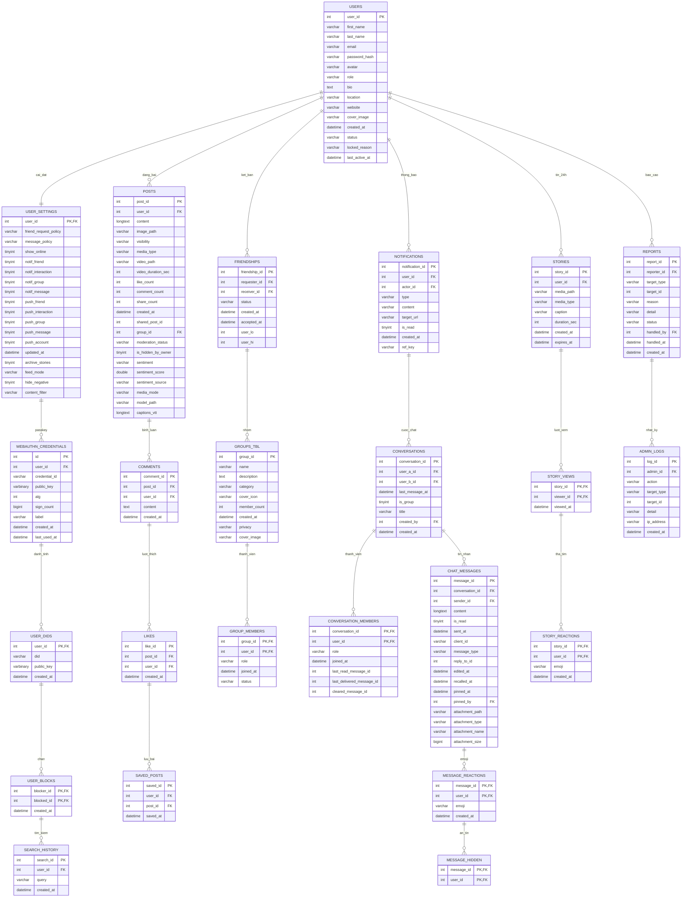

# THIẾT KẾ CƠ SỞ DỮ LIỆU & SƠ ĐỒ THỰC THỂ (ERD) - DỰ ÁN UTErSPACE

Tài liệu này cung cấp toàn bộ **sơ đồ quan hệ thực thể (Entity-Relationship Diagram)** và **đặc tả chi tiết 24 bảng dữ liệu** của mạng xã hội UTErSpace (chạy trên MySQL 8.4 Local, database `defaultdb`).

---

## 1. Sơ Đồ Quan Hệ Thực Thể (ERD - Mermaid Diagram)

---

## 2. Đặc Tả Chi Tiết 24 Bảng Dữ Liệu Theo Module

### Module 1: Quản Lý Người Dùng & Xác Thực Bảo Mật
1. **`users`**: Lưu trữ thông tin tài khoản (Sinh viên HCMUTE, Giảng viên, Quản trị viên).
   * `user_id` (INT, PK, Auto Increment): Mã định danh duy nhất.
   * `first_name`, `last_name` (VARCHAR): Họ và tên tiếng Việt có dấu.
   * `email` (VARCHAR, Unique): Email sinh viên (`@student.hcmute.edu.vn`) hoặc email quản trị.
   * `password_hash` (VARCHAR): Mật khẩu băm an toàn theo giải thuật BCrypt (cost = 12).
   * `avatar`, `cover_image` (VARCHAR): Đường dẫn ảnh đại diện và ảnh bìa trên Cloudinary / Local.
   * `role` (VARCHAR): Phân quyền (`USER`, `ADMIN`).
   * `status` (VARCHAR): Trạng thái tài khoản (`ACTIVE`, `LOCKED`).
   * `last_active_at` (DATETIME): Thời gian hoạt động gần nhất để hiển thị trạng thái online.

2. **`user_settings`**: Cài đặt cá nhân hóa của từng người dùng.
   * `user_id` (INT, PK, FK -> `users.user_id`).
   * `friend_request_policy`, `message_policy`: Quyền riêng tư nhận tin nhắn / kết bạn.
   * `show_online`: Ẩn/hiện trạng thái đang hoạt động.
   * `feed_mode`: Chế độ hiển thị bảng tin (`SMART` - thuật toán gợi ý, hoặc `LATEST` - mới nhất).
   * `hide_negative`: Tự động ẩn bài viết có cảm xúc tiêu cực được gắn nhãn bởi AI.

3. **`user_dids`**: Danh tính số phi tập trung (Decentralized Identity - `did:key` dùng Ed25519).
   * `user_id` (INT, PK, FK -> `users.user_id`).
   * `did` (VARCHAR, Unique): Định danh DID theo chuẩn W3C.
   * `public_key` (VARBINARY): Khóa công khai của người dùng.

4. **`webauthn_credentials`**: Khóa xác thực sinh trắc học (Passkey / FIDO2 - Vân tay & FaceID).
   * `id` (INT, PK), `user_id` (INT, FK -> `users.user_id`).
   * `credential_id` (VARCHAR, Unique), `public_key` (VARBINARY), `sign_count` (BIGINT).

5. **`user_blocks`**: Quản lý chặn người dùng.
   * `blocker_id`, `blocked_id` (PK, FK -> `users.user_id`).

6. **`search_history`**: Lịch sử tìm kiếm để phục vụ thuật toán Recommendation System.
   * `search_id` (INT, PK), `user_id` (INT, FK), `query` (VARCHAR).

---

### Module 2: Bảng Tin, Bài Đăng & Tương Tác
7. **`posts`**: Lưu trữ bài viết mạng xã hội (Ảnh, Video, Mô hình 3D AR, Bài viết nhóm).
   * `post_id` (INT, PK, Auto Increment).
   * `user_id` (INT, FK -> `users.user_id`): Tác giả bài viết.
   * `group_id` (INT, FK -> `groups_tbl.group_id`, Nullable): Bài đăng trong nhóm (nếu có).
   * `content` (LONGTEXT): Nội dung văn bản, hỗ trợ hashtag (#).
   * `media_type` (VARCHAR): Loại đa phương tiện (`IMAGE`, `VIDEO`, `MODEL3D`).
   * `image_path`, `video_path`, `model_path`: Liên kết tệp trên Cloudinary.
   * `sentiment`, `sentiment_score`: Nhãn cảm xúc phân tích tự động bằng AI (`POSITIVE`, `NEUTRAL`, `NEGATIVE`).
   * `visibility`: Phạm vi chia sẻ (`PUBLIC`, `FRIENDS`, `PRIVATE`, `GROUP`).
   * `like_count`, `comment_count`, `share_count` (INT): Bộ đếm tối ưu hiệu năng trang feed.

8. **`comments`**: Bình luận bài viết.
   * `comment_id` (INT, PK), `post_id` (INT, FK), `user_id` (INT, FK), `content` (TEXT).

9. **`likes`**: Lượt thích bài viết.
   * `like_id` (INT, PK), `post_id` (INT, FK), `user_id` (INT, FK).

10. **`saved_posts`**: Bài viết được người dùng lưu lại.
    * `saved_id` (INT, PK), `user_id` (INT, FK), `post_id` (INT, FK).

---

### Module 3: Quan Hệ Bạn Bè & Cộng Đồng Nhóm
11. **`friendships`**: Quan hệ kết bạn hai chiều.
    * `friendship_id` (INT, PK), `requester_id` (INT, FK), `receiver_id` (INT, FK).
    * `status` (VARCHAR): `PENDING` (chờ chấp nhận), `ACCEPTED` (đã là bạn bè).
    * `user_lo`, `user_hi` (VIRTUAL GENERATED): Cột ảo tự động sắp xếp `LEAST`/`GREATEST` đảm bảo chống trùng lặp quan hệ.

12. **`groups_tbl`**: Nhóm cộng đồng (Học tập, CLB Robotics, Nhiếp ảnh, Đồ án...).
    * `group_id` (INT, PK), `name` (VARCHAR), `description` (TEXT), `privacy` (VARCHAR), `cover_image` (VARCHAR), `member_count` (INT).

13. **`group_members`**: Thành viên trong nhóm.
    * `group_id` (INT, PK, FK), `user_id` (INT, PK, FK), `role` (`ADMIN`, `MODERATOR`, `MEMBER`), `status` (`ACTIVE`, `PENDING`).

---

### Module 4: Nhắn Tin Trực Tuyến & Thông Báo Thời Gian Thực
14. **`conversations`**: Cuộc trò chuyện (1-1 hoặc Nhóm chat).
    * `conversation_id` (INT, PK), `is_group` (TINYINT), `user_a_id`, `user_b_id` (FK, Nullable nếu là nhóm), `title` (VARCHAR).

15. **`conversation_members`**: Thành viên nhóm chat.
    * `conversation_id` (INT, PK, FK), `user_id` (INT, PK, FK), `last_read_message_id` (INT).

16. **`chat_messages`**: Tin nhắn trò chuyện (văn bản, ảnh, tệp đính kèm, trả lời, ghim, thu hồi).
    * `message_id` (INT, PK), `conversation_id` (INT, FK), `sender_id` (INT, FK).
    * `content` (LONGTEXT), `message_type` (`TEXT`, `IMAGE`, `FILE`), `attachment_path` (VARCHAR).
    * `pinned_at`, `pinned_by`, `recalled_at`, `edited_at` (DATETIME).

17. **`message_reactions`**: Thả biểu tượng cảm xúc (Emoji reaction) trên tin nhắn.
    * `message_id` (INT, PK, FK), `user_id` (INT, PK, FK), `emoji` (VARCHAR).

18. **`message_hidden`**: Ẩn tin nhắn ở phía người dùng.
    * `message_id` (INT, PK, FK), `user_id` (INT, PK, FK).

19. **`notifications`**: Thông báo hệ thống thời gian thực (WebSocket Push).
    * `notification_id` (INT, PK), `user_id` (INT, FK - người nhận), `actor_id` (INT, FK - người thực hiện).
    * `type` (`LIKE`, `COMMENT`, `FRIEND_REQUEST`, `MESSAGE`, `GROUP`), `content` (VARCHAR), `target_url` (VARCHAR), `is_read` (TINYINT).

---

### Module 5: Tin 24 Giờ (Story) & Quản Trị Hệ Thống
20. **`stories`**: Tin biến mất sau 24 giờ.
    * `story_id` (INT, PK), `user_id` (INT, FK), `media_path` (VARCHAR), `expires_at` (DATETIME).

21. **`story_views`**: Lượt xem tin.
    * `story_id` (INT, PK, FK), `viewer_id` (INT, PK, FK), `viewed_at` (DATETIME).

22. **`story_reactions`**: Thả tim tin 24h.
    * `story_id` (INT, PK, FK), `user_id` (INT, PK, FK), `emoji` (VARCHAR).

23. **`reports`**: Báo cáo vi phạm nội dung từ người dùng.
    * `report_id` (INT, PK), `reporter_id` (INT, FK), `target_type` (`POST`, `COMMENT`, `USER`), `target_id` (INT), `status` (`PENDING`, `RESOLVED`, `DISMISSED`), `handled_by` (INT, FK).

24. **`admin_logs`**: Nhật ký kiểm toán hành động của Quản trị viên (Audit Log).
    * `log_id` (INT, PK), `admin_id` (INT, FK), `action` (VARCHAR), `target_type` (VARCHAR), `detail` (VARCHAR), `ip_address` (VARCHAR).
